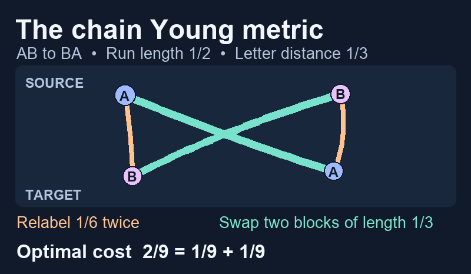

# Attainment of the chain Young metric on rational step words

[](https://github.com/DannyExperiments/chain-young-metric-attainment/actions/workflows/verify.yml) [](https://github.com/DannyExperiments/chain-young-metric-attainment/actions/workflows/replay.yml) [](https://github.com/DannyExperiments/chain-young-metric-attainment/actions/workflows/pdf.yml)

Messick asked whether a cheapest finite chain exists between two rational step words of the same length when letter distances are rational. It does. Rational distances between each source letter and each target letter suffice, and an optimal chain can use only letters from the two words.

[Read the paper](paper/manuscript.pdf) · [LaTeX source](paper/manuscript.tex) · [Original conjecture, p. 35 footnote 2](https://ecommons.cornell.edu/server/api/core/bitstreams/e61833ea-c15d-40a3-8e93-e0310d91055d/content#page=46) · [Catalog Q114](https://github.com/10m-u/open-problems-catalog/blob/ca8d4d44ba3db527f19f28928c240168f545ecfe/problems/mathematics/logic-foundations-set-theory-part-1.md#q114)

## Explore the proof in 3D



Turn **AB** into **BA** with two runs of length ½ and letter distance ⅓. The green strands carry mass ⅓ each and keep their letters. They exchange order, costing 1/9. The orange strands carry mass ⅙ each and change letters, costing another 1/9. On the half-unit grid the best cost is ¼. The explorer lets you compare exact costs and read the corresponding legal edits on four rational grids.

[Download the offline explorer](https://raw.githubusercontent.com/DannyExperiments/chain-young-metric-attainment/main/visualization/chain-young-metric-explorer.zip) · [Explorer source](visualization/index.html) · [GIF rendering source](visualization/render.py)

## Why the proof works

A finite chain assigns every source interval to a target run. Assigning mass from a source letter to a different target letter contributes its length times the letter distance. Two groups of intervals that reverse order contribute the product of their lengths. Those terms give a quadratic objective over the possible transport plans.

Conversely, a rational transport plan packs consecutive grid cells into runs, relabels cells directly and realizes the required swaps. Classical quadratic programming supplies a rational minimizer when the cross-distances are rational. For a two-letter distance that is irrational and less than ½, the example in the paper has only an irrational optimal transport plan. The finite-chain infimum in that example is therefore unattained.

## Reproduce the checks

```sh
python3 -I scripts/verify_repository.py
python3 -I verification/src/replay.py
```

The [recorded exact checks](verification/results/replay.txt) compare fixed-grid shortest paths with run-transport optimization on 1,243 word pairs and replay the three-move chain. The [manuscript](paper/manuscript.pdf) proves the general result. See [reproducibility](REPRODUCIBILITY.md), [scope](CLAIM_SCOPE_AND_LIMITATIONS.md) and [research disclosure](AI_DISCLOSURE.md).
